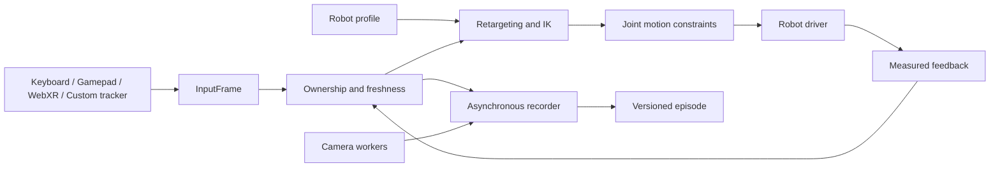

# KineWeave

**Modular teleoperation and timestamped data capture across robot embodiments.**

I built KineWeave to separate an operator's intent from a robot's control interface. It gives me one path from keyboard, gamepad or WebXR tracking to named-joint and end-effector targets, while recording what was requested, what the driver sent and what the robot actually reported.

The central idea is simple: adding a robot should mean describing its joints and kinematics, then implementing its driver. Adding an input device should mean producing a common input packet. Neither change should require rewriting the recorder or the operator console.

## What it does

- **Multiple robot layouts:** configurable joint names, units, control groups, limits, kinematic chains and gripper/hand mappings. Bundled examples cover 6, 7, 24, 29 and 43 coordinates.
- **Several input paths:** keyboard, browser gamepads, WebXR controllers and hand tracking, plus HTTP input for external trackers and custom devices.
- **Retargeting and IK:** relative pose anchoring, coordinate conversion, bounded damped-least-squares IK and grasp-synergy mapping.
- **Controlled execution:** explicit arming, continuously held enable, exclusive input ownership, expiring commands, joint motion limits and a latched software stop.
- **Traceable recording:** asynchronous HDF5, complete JSONL samples/events, timestamped JPEG frames, incomplete-session detection and SHA256 manifests.
- **Inspection and replay:** a local browser console, schematic robot view, display-only episode replay, CSV export and optional MP4 previews.
- **Driver adapters:** an integrated simulator, a bridge to the existing G2 GDK execution stack, Unitree G1/Dex3 DDS adapters and a third-party driver factory interface.

The current hardware adapters have been checked with fake SDKs. Physical robots, firmware configurations, controllers and headsets still need target-device acceptance. All bundled robot geometry and limits are demonstration configurations, not calibrated hardware models.

## Quick start

Python 3.10 or newer is required. The recorded verification environment uses Python 3.12. Hardware SDKs are optional and belong in their vendor-supported environments.

```bash
git clone https://github.com/SILVIO-ZHENG/kineweave.git
cd kineweave
python -m venv .venv
```

Activate the environment on Linux or macOS:

```bash
source .venv/bin/activate
```

Or in Windows PowerShell:

```powershell
.\.venv\Scripts\Activate.ps1
```

Install and start the simulator:

```bash
python -m pip install -e .
kineweave profiles
kineweave serve --robot g2_24 --driver sim --open
```

The server prints a URL containing `#token=...`. Open that complete URL; the plain address without the token cannot access the API. The default listener is `127.0.0.1:8765`.

Windows users can also run [Setup.ps1](Setup.ps1), then double-click [Start.cmd](Start.cmd). Convenience launchers always use simulation. Choose another layout with:

```powershell
.\Start.ps1 -Robot g1_43
```

The Python module entry point remains available as `python -m teleop_v2`.

## Robot layouts

| Profile | Recorded coordinates | Example layout |
|---|---:|---|
| `arm6` | 6 | Generic six-axis arm |
| `arm7` | 7 | Generic seven-axis arm |
| `g2_24` | 24 | Two seven-axis arms, two grippers, head and waist coordinates |
| `g1_29` | 29 | G1 body layout with two arm tasks |
| `g1_43` | 43 | G1 body layout plus two seven-coordinate Dex3 hands |

Recorded dimension and controlled dimension are declared separately. A 43-coordinate profile does not imply direct control of every joint or whole-body balance. The G1 adapter uses the upper-body `arm_sdk` and optional Dex3 paths; walking and direct leg control are outside this implementation.

Use a JSON profile or import selected URDF chains for another robot. See [robot profiles](docs/ROBOT_PROFILES.md) and [extension examples](docs/EXTENDING.md).

## Operator workflow

1. Check the selected robot and driver mode.
2. Select a task or a named joint, then click **Arm**.
3. Hold the enable input to move. Release it to hold at the measured pose.
4. Use **Re-anchor** to establish a new relative origin. **Pause** releases input ownership.
5. Start recording, perform the task, then stop and seal the episode.

| Input | Default mapping |
|---|---|
| Keyboard | Hold Space or the on-screen enable button. Arrows move XY; W/S move Z; I/K, U/O and J/L rotate X/Y/Z. |
| Gamepad | LB/button 4 enables. Axes 0/1 move XY, axis 3 moves Z, axis 2 rotates Z and button 7 controls grasp. |
| Named joint | Select an allowed coordinate and move its slider; arming and held enable still apply. |
| WebXR controller | Grip pose drives the corresponding arm; button 1 enables and button 0 controls grasp. |
| WebXR hand | Wrist pose drives the arm; thumb/index pinch enables and controls grasp. Available hand joints are retained as raw data. |

Gamepad mappings depend on the browser. WebXR requires the device browser to support the requested immersive mode and tracking. Remote XR clients need trusted HTTPS; TLS certificate and key options are provided. Hand tracking currently controls a grasp synergy, not independent fingertip IK.

The browser sends approximately every 50 ms and control defaults to 50 Hz. Input expires after 0.3 seconds by default. Paused or stale motion is not queued for later execution. Software stop stays latched until **Reset**, followed by a new **Arm**; it does not replace the physical robot's emergency stop.

## Record and inspect data

Generate local examples without connecting to hardware:

```bash
kineweave demo --robot g1_43 --seconds 3 --output recordings
kineweave demo --all-profiles --seconds 0.5 --output recordings
```

For an explicitly selected OpenCV camera:

```bash
python -m pip install -e '.[camera]'
kineweave serve --robot g2_24 --driver sim --camera head=0 --open
```

Each episode contains a robot profile, task/clock metadata, numeric HDF5, complete JSONL samples, input/runtime events, timestamped JPEGs and a hashed manifest. The `INCOMPLETE` marker remains until successful sealing.

Replace `EPISODE` with an actual directory. Keep exports outside a sealed episode:

```bash
kineweave inspect recordings/EPISODE
kineweave export recordings/EPISODE --output exports/session.csv
kineweave replay recordings/EPISODE
kineweave export-video recordings/EPISODE --camera head --output exports/head.mp4 --fps 15
```

The console can load an episode and scrub its state and nearest timestamped camera frames. Replay affects display only. MP4 export is a constant-rate preview with original timestamps retained separately; neither replay nor export proves hardware-level camera synchronization. See the [data format](docs/DATA_FORMAT.md) for evidence, clocks and integrity checks.

## Architecture



The generic guard handles joint positions, rates and command lifetime. It is not a collision planner, contact simulator or humanoid balance controller. The G2 bridge retains its existing vendor execution protections. New drivers supply their platform's hold, watchdog and control-ownership behavior.

## Hardware integration

Hardware connections are read-only by default. Physical writes require `--execute`, a site-validated profile and the adapter's reviewed configuration. Changing a metadata flag is not acceptance testing.

- **G2:** requires a compatible external Nexus `G2AAdapter` installation and `agibot_gdk`; neither is bundled here. `--nexus-root` selects that installation, and `--g2-cameras` enables its native camera worker.
- **G1 / Dex3:** requires official Unitree SDK2 Python, an explicit network interface, verified motor maps, reviewed gains and robot-side watchdog behavior. Read-only mode creates no command publishers.
- **Other robots:** implement `RobotDriver` and load it using `--driver my_robot.driver:make_driver`. Input, recording and console interfaces stay the same.

See [hardware adapters](docs/HARDWARE_ADAPTERS.md) for assumptions and [extending KineWeave](docs/EXTENDING.md) for working examples.

## Verification

The verification record includes **74 focused tests**, static checks, JavaScript syntax checks, real loopback HTTP tests and synthetic JPEG/MP4 round trips. It covers several robot dimensions, stale input/feedback, source ownership, IK failures, stop latching, SDK rejection, recording overflow and tamper detection.

```bash
python -m pip install -e '.[dev,camera]'
python -m pytest tests -q
python -m ruff check src tests
```

These checks establish software behavior in simulation and fake SDK environments. Physical robot, firmware and headset acceptance remain separate. See [the verification record](docs/VALIDATION.json) for the environment and limits.

## Documentation

- [Architecture and runtime](docs/ARCHITECTURE.md)
- [Input and HTTP protocol](docs/INPUT_PROTOCOL.md)
- [Robot profiles and URDF import](docs/ROBOT_PROFILES.md)
- [Hardware adapters](docs/HARDWARE_ADAPTERS.md)
- [Extending robots, drivers and inputs](docs/EXTENDING.md)
- [Recording format](docs/DATA_FORMAT.md)

## References

KineWeave integrates with existing robot interfaces. Relevant upstream projects and specifications include the [Unitree SDK2 Python](https://github.com/unitreerobotics/unitree_sdk2_python), [Unitree XR teleoperation examples](https://github.com/unitreerobotics/xr_teleoperate), the existing [G2 collection and execution project](https://github.com/SILVIO-ZHENG/VLA_RL_collect_data) and the [WebXR Device API](https://immersive-web.github.io/webxr/).
