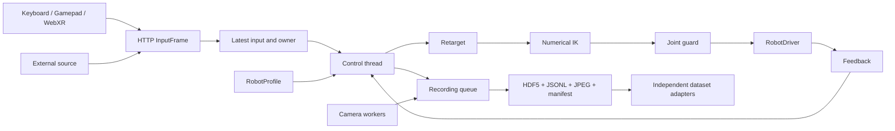

# Modules and runtime architecture

KineWeave separates device input, common intent, kinematics/constraints, drivers and measured feedback. Recording preserves evidence alongside this path. SDKs do not parse input devices, and input devices do not choose robot vector order.

## 1. Module responsibilities

| File | Responsibility |
|---|---|
| `types.py` | RobotProfile, JointSpec, Pose, InputFrame, RobotState and RobotDriver contracts |
| `profiles.py` | Built-in discovery, custom JSON and serial-chain URDF import without SDK loading |
| `kinematics.py` | FK, schematic chain points and numerical IK, not dynamics/collision/balance |
| `control.py` | Relative anchoring, WebXR basis conversion, grasp synergy and joint constraints |
| `drivers.py` | Simulation, G2 Nexus bridge and G1 Unitree DDS with lazy SDK imports |
| `runtime.py` | Single-writer control, ownership, expiry, state machine and recording coordination |
| `recording.py` | Bounded asynchronous storage, sealing, reading and export |
| `cameras.py` | Opt-in capture workers and optional video export |
| `server.py` | Local session-token console, API and TLS |
| `web/` | Build-free console, device input, schematic visualization and display-only replay |
| `cli.py` | Profiles, serve, demo, inspect, replay, CSV and video export commands |

## 2. Threads, timing and ownership

HTTP threads validate InputFrame and replace the latest input under a lock; they do not queue motion. The control thread serializes feedback read → feedback timing checks → ownership/freshness checks → retargeting → optional IK → JointGuard → driver write → complete sample recording. Robot writes have one serialized path. Actions coordinate hold, reset and recording changes under the same lock. This is not a hard real-time system.

Only one source_id owns control at a time. Arming requires a fresh packet from that source. Hold retains ownership and later valid packets from that owner may resume. Pause/disarm clears ownership and latest input; changing source requires a fresh packet and re-arm. Clients submit intent and cannot bypass server constraints to call an SDK.

The recorder worker owns HDF5/JSONL/JPEG writes; control calls validate, snapshot and enqueue without blocking on disk. Overflow raises instead of overwriting samples. Camera workers capture and encode JPEGs independently. Recording actions use a separate recording lock. File creation, draining and sealing hashes run outside the control lock, allowing control ticks while the HTTP action awaits sealing.

## 3. State machine

| State | Meaning | Exit |
|---|---|---|
| `disarmed` | No armed source | Fresh input then Arm |
| `armed` | Owner selected, waiting for valid enable | Valid enabled input activates; otherwise hold |
| `active` | Current tick passes checks and writes | Release, expiry, clutch, invalid tracking or missed deadline → hold |
| `hold` | Hold and reset anchors, retaining owner | Fresh valid owner input → active; Pause → disarmed |
| `estop` | Latched software stop | Reset → disarmed, then Arm |
| `fault` | Feedback, dispatch or recording failure | Resolve cause, Reset and obtain valid feedback |

Activation requires armed ownership, matching source, unexpired receive time, enabled=true, clutch=false, valid=true and confidence≥0.5. Timeout defaults to 0.3 seconds and supports 0.05..2 seconds. Control frequency supports 5..200 Hz. A tick over 0.1 seconds discards latest input and holds. Feedback timestamps use server-process monotonic nanoseconds; stale or future feedback faults.

Solver time also consumes the command lifetime. The runtime checks again before dispatch so slow IK cannot send an already expired target. A failed hold revokes source ownership before the SDK error is reported. Pause/disarm cannot clear the latched software stop; only a successful explicit reset does that.

## 4. Coordinates, IK and constraints

All N-coordinate vectors follow profile joint order. Positions use metres, revolute joints radians and quaternions XYZW. Robot-base axes are forward/left/up; WebXR right/up/forward-negative-Z is transformed before retargeting. Tracked poses use relative anchoring: current device pose corresponds to current measured robot task pose, then later relative motion is mapped. Release, tracking loss and re-enable rebuild anchors rather than catching up paused motion.

IK solves the profile's configured serial chains. Unreachable/unconverged goals hold without sending partial solutions. Direct joints cannot overlap an active IK chain; grasp and direct finger targets cannot conflict. Grasp linearly interpolates profile open/closed endpoints; it is not full hand-skeleton inverse kinematics.

JointGuard enforces positions and dt-based velocity/acceleration limits; unselected groups preserve fresh measured coordinates. It does not provide obstacle/self-collision avoidance, force control, contact dynamics or G1 balance. The G2 bridge retains its existing safety path. G1 robot-side watchdogs, stabilization and gains require site validation.

## 5. Recording boundary

Samples separately retain measured state/velocity, requested intent, post-guard command and receipt dispatch evidence. Publication success does not prove target attainment. Camera records preserve source and receive clocks; process monotonic values are not a global join clock. See [Data format](DATA_FORMAT.md).

Independent dataset adapters own clock alignment, command interpretation, annotations and downstream dataset splits. Keeping that work outside the control path lets applications reuse the recorded evidence without adding dependencies to teleoperation.

## 6. Current validation scope

Simulation checks key paths across dimensions, expiry/ownership, guards and recording/verification/replay. Fake SDKs check G2/G1 mapping and message behavior. They cannot establish real firmware timing, protection, finger motor direction, network reliability or robot task success. Demonstration geometry is not a hardware model. Actual browser/device capability determines XR support; comprehensive XR coverage is not claimed.
